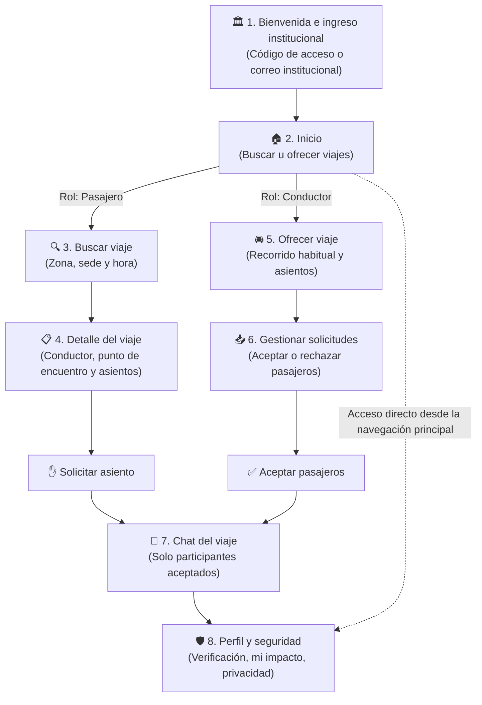
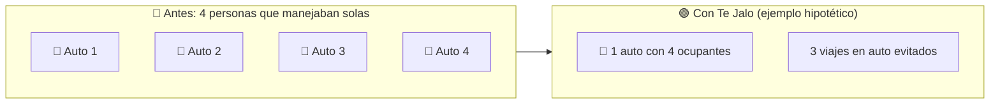
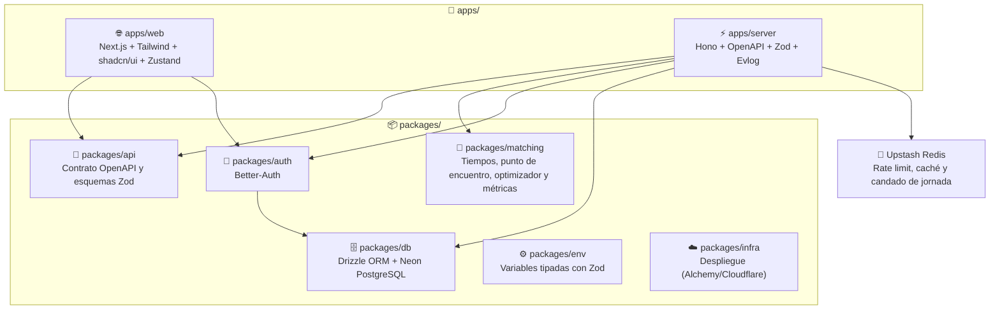

<div align="center">

# 🚗 Te Jalo — Movilidad Compartida Inteligente

### _Viajes compartidos entre colegas verificados que ya van a la misma sede en Lima_

[](https://github.com/hack-andes-buscandoanemo/andes-hack/stargazers)
[](https://github.com/hack-andes-buscandoanemo/andes-hack/commits/main)
[](https://github.com/hack-andes-buscandoanemo/andes-hack/issues)
[](https://github.com/hack-andes-buscandoanemo)

<p align="center">
  
  
  
  
  
  
  
  
  
  
</p>

---

[**👤 Usuario y problema**](#-usuario-y-problema) · [**✨ Qué hace**](#-qué-hace) · [**📏 Impacto**](#-cómo-medimos-el-impacto) · [**🏗️ Arquitectura**](#️-arquitectura) · [**⚖️ Decisiones**](#️-decisiones-y-tradeoffs) · [**🚧 Qué quedó fuera**](#-qué-quedó-fuera) · [**📚 Datos**](#-datos-y-supuestos) · [**🥊 Competencia**](#-competencia) · [**🚀 Inicio rápido**](#-inicio-rápido)

</div>

---

## 🌟 Resumen

**Te Jalo** conecta a miembros verificados de una misma organización (empresas privadas primero) que hacen recorridos parecidos hacia su sede. Así, quien maneja solo puede llevar a colegas en los asientos que hoy van vacíos. Un **motor de emparejamiento** cruza rutas, horarios y puntos de encuentro, y propone los viajes que **evitan más viajes en auto**.

Los viajes son **seguros por diseño**: solo viajan personas de la misma comunidad cerrada, verificadas por correo institucional o código de acceso. Esto reduce riesgos, pero no los elimina, y la app no promete seguridad absoluta.

> [!IMPORTANT]
> **Te Jalo no cobra.** No procesa pagos ni muestra tarifas: muestra un **estimado de combustible** del trayecto y cuánto sería por ocupante, como referencia para un aporte voluntario fuera de la app. El porqué está en [Decisiones y tradeoffs](#️-decisiones-y-tradeoffs) y en [ADR 0001](docs/decisiones/0001-sin-pagos-en-la-app.md).

> [!NOTE]
> **Alcance del MVP — regreso:** Te Jalo permite buscar y coordinar el regreso, sujeto a viajes disponibles y a la aceptación del conductor. La disponibilidad del regreso no está asegurada. El MVP no ofrece una garantía institucional pagada de regreso.

---

## 👤 Usuario y problema

**Protagonista: quien hoy maneja solo hacia la sede de su organización.** Por ejemplo, Carlos vive en La Molina y trabaja en el Centro Empresarial Real, en San Isidro. Son **15,77 km por calle** según la matriz OSRM del repositorio, y cada mañana los recorre con tres asientos vacíos.

**Quién decide y paga:** RR. HH., bienestar o facilities de la organización, que buscan un beneficio de movilidad para su gente y menos presión sobre su estacionamiento. Los miembros no pagan nada a la app ni entre sí dentro de ella.

**Quién más gana:** colegas que hoy van en bus, combi, Corredor o metro. Para ellos el viaje en auto con alguien de su comunidad es más seguro por diseño y **más predecible** que esperar en un paradero en hora punta. Eso no quiere decir que sea más rápido: el auto también queda atrapado en el tráfico.

| Dolor                                                                                            | Cómo responde Te Jalo                                                                                                                                                            |
| :----------------------------------------------------------------------------------------------- | :------------------------------------------------------------------------------------------------------------------------------------------------------------------------------- |
| 🛡️ **Inseguridad** al viajar con desconocidos                                                    | Comunidades cerradas, verificación institucional, opción de **viajar solo con mujeres** y **compartir el viaje** con un contacto de confianza. Seguro por diseño, sin garantías. |
| ⏳ **Esperas impredecibles** en hora punta                                                       | Horario y punto de encuentro acordados antes de salir, con tiempos estimados según la hora del día (factores de tráfico de TomTom).                                              |
| ⛽ **Costo** de manejar solo                                                                     | Un estimado de combustible por ocupante para hablar de un aporte voluntario, sin cobro en la app.                                                                                |
| 🚦 **Tráfico**: solo el 7 % de las personas va a trabajar principalmente en su auto, pero satura | Medimos los **viajes en auto evitados** netos, no solo las personas transportadas.                                                                                               |

---

## ✨ Qué hace

El flujo completo funciona contra la API pública: ingreso institucional, oferta y búsqueda de viajes, solicitud y aceptación de asiento, y chat.



|   #   | Pantalla                               |     Rol      | Qué hace                                                                                                                                                             |
| :---: | :------------------------------------- | :----------: | :------------------------------------------------------------------------------------------------------------------------------------------------------------------- |
| **1** | **Bienvenida e ingreso institucional** |    Ambos     | Crear cuenta, unirse a una comunidad con un código de acceso o un correo institucional, aceptar el consentimiento y declarar cómo viaja hoy.                         |
| **2** | **Inicio**                             |    Ambos     | Elegir entre buscar u ofrecer un viaje y ver los viajes propios.                                                                                                     |
| **3** | **Buscar viaje**                       | 👤 Pasajero  | Buscar ofertas compatibles según zona, sede y hora, respondiendo "Si no encuentras viaje, ¿cómo irías?".                                                             |
| **4** | **Detalle del viaje**                  | 👤 Pasajero  | Ver al conductor, el punto de encuentro, la caminata, el desvío, el estimado de combustible y los asientos, y **solicitar un asiento**.                              |
| **5** | **Ofrecer viaje**                      | 🚘 Conductor | Publicar un viaje de ida o de regreso a la sede, para una fecha o recurrente por días, con sus asientos (opción "solo mujeres").                                     |
| **6** | **Gestionar solicitudes**              | 🚘 Conductor | **Aceptar o rechazar** solicitudes; la reserva del asiento es atómica. Un admin de la comunidad corre el emparejamiento de la jornada (`/comunidad/emparejamiento`). |
| **7** | **Chat del viaje**                     |    Ambos     | Coordinar hora y punto de encuentro entre el conductor y los pasajeros aceptados.                                                                                    |
| **8** | **Perfil y seguridad**                 |    Ambos     | Verificación, foto, modo habitual, **mi impacto**, enlace para compartir el viaje y eliminar mis datos.                                                              |

Además hay tres páginas públicas: **`/panel`**, el impacto de la comunidad; **`/datos`**, cada cifra con su fuente o supuesto; e **`/instituciones`**, la lista de espera para organizaciones.

---

## 📏 Cómo medimos el impacto

La cifra principal son los **viajes en auto evitados netos**, contados aparte de las personas transportadas ([ADR 0003](docs/decisiones/0003-metrica-viajes-en-auto-evitados.md), `packages/matching/src/metrics.ts`).

**Ejemplo hipotético.** Si 4 personas que manejaban solas comparten un auto, se pasa de **4 autos a 1**, y se evitan **3 viajes en auto**. Si solo 3 de las 4 comparten, quedan **2 autos** (el compartido y el de quien sigue manejando solo), y se evitan **2**. Si en cambio el auto lleva a 3 colegas que venían en bus, se evitan **0 viajes en auto**: ganan seguridad y previsibilidad, pero el tráfico no cambia.



- Un asiento **evita un viaje en auto** solo si el pasajero respondió que, sin viaje, manejaría solo o tomaría un taxi o una app.
- Un conductor que antes no hacía ese trayecto en auto **induce** un viaje; la cifra neta lo resta.
- **Potencial** cuenta asientos aceptados; **verificado**, viajes completados. Los km y el CO₂ evitados son **estimados** y descuentan el desvío.
- Las cuentas del equipo no cuentan para ninguna cifra.

---

## 🏗️ Arquitectura

Monorepo con **Bun** y **Turborepo**. La API y la web se despliegan en **Cloudflare** (Workers y OpenNext) con Alchemy, y la base de datos es **Neon** (Postgres).



- **`packages/matching`**: TypeScript puro, sin dependencias de ejecución ni acceso a la base. Estima tiempos con una matriz OSRM entre lugares reales de Lima y factores de tráfico por hora. También calcula el mejor punto de encuentro y el desvío (inserción), asigna los asientos de una jornada (inserción por arrepentimiento + búsqueda local) y lo compara con "primero en llegar".
- **`packages/api`**: un solo contrato OpenAPI generado desde Zod. La web consume tipos generados a partir de él (`openapi-typescript`).
- **`packages/db`**: esquema relacional con restricciones en la base (por ejemplo, `seats_taken BETWEEN 0 AND seats_total`) y migraciones versionadas. Los tests corren contra Postgres real (PGlite).

```text
andes-hack/
├── apps/
│   ├── web/            # Next.js, Tailwind CSS, shadcn/ui, Zustand, TanStack Form, Motion
│   └── server/         # Hono, OpenAPI, Upstash Redis/Ratelimit, Resend, R2
├── packages/
│   ├── api/            # Contrato OpenAPI y esquemas Zod compartidos
│   ├── auth/           # Better-Auth
│   ├── db/             # Esquema Drizzle, migraciones y seed (Neon)
│   ├── env/            # Variables de entorno tipadas con Zod
│   ├── infra/          # Despliegue con Alchemy
│   ├── matching/       # Motor de emparejamiento y métricas de impacto
│   └── config/         # Configuraciones compartidas
├── docs/decisiones/    # ADR breves
├── AGENTS.md / CLAUDE.md
└── bts.jsonc           # Stack Graph de Better Fullstack
```

---

## ⚖️ Decisiones y tradeoffs

| Decisión                                                                                                           | Por qué                                                                                                                                                                                                                                     | Qué cuesta                                                                                                                |
| :----------------------------------------------------------------------------------------------------------------- | :------------------------------------------------------------------------------------------------------------------------------------------------------------------------------------------------------------------------------------------ | :------------------------------------------------------------------------------------------------------------------------ |
| **La app no cobra** ([ADR 0001](docs/decisiones/0001-sin-pagos-en-la-app.md))                                      | El RNAT (D.S. 017-2009-MTC, art. 3, num. 3.61) define el transporte privado como el traslado sin contraprestación, sin excepción por compartir gastos. Compartir gastos dentro de la app llegaría solo con una opinión de la ATU o del MTC. | Sin ingresos por viaje: el modelo depende de que la institución pague. Los ocupantes conversan el aporte fuera de la app. |
| **Motor en TypeScript puro**, no OR-Tools en Python ([ADR 0002](docs/decisiones/0002-motor-en-typescript-puro.md)) | Corre en el mismo Worker, comparte tipos con la API y se prueba con Vitest.                                                                                                                                                                 | Es una heurística: alcanza el óptimo exhaustivo en al menos el 95 % de 200 jornadas pequeñas (test), no en todas.         |
| **Métrica: viajes en auto evitados netos** ([ADR 0003](docs/decisiones/0003-metrica-viajes-en-auto-evitados.md))   | Contar personas exagera el impacto: la mayoría de pasajeros viene del transporte público.                                                                                                                                                   | La cifra es más chica y depende de lo que cada persona declara. Priorizarla puede dejar sin asiento a quien viene en bus. |
| **Reserva atómica con `neon-http`** ([ADR 0004](docs/decisiones/0004-reserva-atomica-con-neon-http.md))            | El driver HTTP no tiene transacciones; una sola sentencia SQL con CTE reserva el asiento y acepta la solicitud a la vez.                                                                                                                    | Cada operación atómica debe caber en una sentencia, más difícil de leer que una transacción.                              |
| **Comunidad cerrada** con código de acceso o correo institucional                                                  | Es lo que hace el viaje seguro por diseño sin pedir documentos.                                                                                                                                                                             | No verifica identidad legal (DNI), licencia ni SOAT.                                                                      |
| **Todo viaje pasa por la sede** (ida hacia ella o regreso desde ella)                                              | Simplifica el emparejamiento: todos los trayectos comparten un extremo.                                                                                                                                                                     | No cubre trayectos entre dos puntos cualesquiera.                                                                         |
| **Chat por consulta periódica** (cada 7 s), no tiempo real                                                         | Funciona en el Worker sin WebSockets ni un servicio aparte.                                                                                                                                                                                 | Un mensaje puede tardar unos segundos en aparecer.                                                                        |
| **Sin datos sintéticos en la demo**: Comunidad Alfa solo tiene lugares reales (OpenStreetMap) y usuarios reales    | Las cifras del panel deben ser evidencia de uso real.                                                                                                                                                                                       | El panel empieza vacío y crece solo con lo que hagan los usuarios de la demo.                                             |

Cada PR documenta además sus propias decisiones en la sección "Decisiones Técnicas y Tradeoffs" de la [plantilla](.github/pull_request_template.md).

---

## 🚧 Qué quedó fuera

| Fuera del MVP                                               | Por qué                                                                                                                                                                                                                                 |
| :---------------------------------------------------------- | :-------------------------------------------------------------------------------------------------------------------------------------------------------------------------------------------------------------------------------------- |
| **Piloto con una organización real**                        | No hubo tiempo de cerrar un acuerdo durante el hackathon. La demo se hace con usuarios reales en **Comunidad Alfa**, una comunidad de demostración, sin datos sintéticos. Las organizaciones interesadas se anotan en `/instituciones`. |
| **Pagos** y compartir gastos dentro de la app               | Postura legal ([ADR 0001](docs/decisiones/0001-sin-pagos-en-la-app.md)).                                                                                                                                                                |
| **Validación de DNI** y **verificación de SOAT o licencia** | Requieren consultar fuentes oficiales y guardar datos sensibles. En el MVP, la confianza viene de la comunidad cerrada.                                                                                                                 |
| **Garantía de regreso pagada por la institución**           | Es un servicio (por ejemplo, un taxi pagado si nadie puede llevarte de vuelta) que cada organización contrataría aparte. El MVP solo coordina el regreso.                                                                               |
| **Chat en tiempo real** y **adjuntos en el chat**           | El chat de texto con consulta periódica basta para coordinar hora y punto de encuentro. Los adjuntos exigen moderar y guardar archivos.                                                                                                 |
| **Seguimiento de ubicación en vivo**                        | Implica datos de ubicación continuos, más sensibles y más difíciles de proteger. Compartir el viaje con un contacto de confianza cubre parte de esa necesidad.                                                                          |
| **Calificaciones entre miembros**                           | Entre colegas de la misma organización, puntuarse genera tensiones. Los problemas se tratan dentro de la comunidad.                                                                                                                     |
| **Chat antes de solicitar asiento**                         | El chat se abre solo entre participantes aceptados, para no exponer al conductor a mensajes de cualquier miembro.                                                                                                                       |
| **Notificaciones push**                                     | Requieren un service worker y gestionar permisos. En el MVP, las solicitudes y los mensajes se ven al abrir la app; el único correo es el código de verificación.                                                                       |
| **Viajes que no pasan por la sede**                         | Todo viaje va hacia la sede o vuelve de ella (ver decisiones).                                                                                                                                                                          |
| **Asientos por día en ofertas recurrentes**                 | Una oferta recurrente tiene un único cupo de asientos (`seats_total`) para todos sus días; llevar la cuenta por fecha queda para después.                                                                                               |
| **Universidades y entidades públicas**                      | Segunda fase. Primero van las empresas, donde RR. HH. o facilities pueden decidir y pagar.                                                                                                                                              |

---

## 📚 Datos y supuestos

Cada constante del motor y cada cifra que la app compara tiene una fuente (`dato`, con enlace) o es un supuesto del equipo (`estimado`). Están en [`packages/matching/src/sources.ts`](packages/matching/src/sources.ts) y se publican en la página [**`/datos`**](https://andes-hack-web-diego.diegorafaelcisnerostafur.workers.dev/datos) (`GET /public/data-sources`). Algunas:

| Cifra                                                 | Valor                                | Tipo     | Fuente                                                                                                                                                                                                              |
| :---------------------------------------------------- | :----------------------------------- | :------- | :------------------------------------------------------------------------------------------------------------------------------------------------------------------------------------------------------------------ |
| Factor de tráfico, día laborable, 8:00                | 2,01 × flujo libre                   | dato     | [TomTom Traffic Index 2025, Lima](https://www.tomtom.com/traffic-index/city/lima/)                                                                                                                                  |
| Tiempos y distancias en auto entre lugares de la demo | matriz todos contra todos            | dato     | OSRM sobre [OpenStreetMap](https://www.openstreetmap.org/copyright) (ODbL)                                                                                                                                          |
| Personas que van a trabajar principalmente en su auto | 7 %                                  | dato     | [Encuesta Lima Cómo Vamos 2024](https://www.limacomovamos.org/wp-content/uploads/2025/01/EncuestaLCV2024.pdf)                                                                                                       |
| CO₂ por galón de gasolina                             | 8,887 kg                             | dato     | [EPA](https://www.epa.gov/greenvehicles/greenhouse-gas-emissions-typical-passenger-vehicle)                                                                                                                         |
| Rendimiento de un auto a gasolina                     | 35 km por galón                      | estimado | Supuesto del equipo                                                                                                                                                                                                 |
| Precio del galón de gasohol regular                   | S/ 22,29 (entre S/ 20,09 y S/ 24,49) | estimado | Punto medio de los precios de [Facilito (Osinergmin), vía Infobae, 17-10-2026](https://www.infobae.com/peru/2026/10/17/consulta-en-este-link-el-precio-de-la-gasolina-mas-barata-y-cara-en-lima-hoy-17-de-octubre/) |
| Pasaje general del Corredor Rojo                      | S/ 2,43                              | dato     | [El Peruano, 17-04-2026](https://www.elperuano.pe/noticia/293781-buscas-ahorrar-en-tus-viajes-conoce-las-tarifas-promocionales-e-integradas-del-corredor-rojo)                                                      |

**Estimado de combustible del ejemplo de Carlos** (15,77 km, `estimateFuelCost`): S/ 10,04 por viaje. Con el auto lleno (4 ocupantes) serían **S/ 2,51 por ocupante**, cerca del pasaje del Corredor Rojo (S/ 2,43). Con 2 ocupantes serían S/ 5,02. Es un estimado de gasolina: no incluye mantenimiento, estacionamiento ni peajes.

**Regla del README:** toda cifra enlaza a su fuente o a `/datos`, y no prometemos lo que no podemos respaldar (ni "garantiza" ni "más rápido").

---

## 🥊 Competencia

Te Jalo no es la primera idea de carpool institucional:

- **AllRide** ofrece carpool corporativo en Perú (además de México, Chile y Panamá), con redes privadas por organización y estadísticas de uso ([app `com.allride.core`](https://play.google.com/store/apps/details?id=com.allride.core)).
- Hay **propuestas académicas** parecidas de carpool universitario y corporativo.
- Grupos de WhatsApp de la oficina, que hacen "primero en llegar" a mano.

**Nuestro diferenciador** no es conectar colegas, sino **optimizar y medir los viajes en auto evitados netos**. El motor asigna los asientos de toda la jornada para maximizar los viajes en auto evitados y se compara con "primero en llegar" en cada corrida. Además, la métrica resta los viajes que induce, y no hay dinero entre colegas dentro de la app.

|                            | 🚌 Transporte público          | 🚕 Taxi por app      | 🚗 Auto propio (solo)     | 💬 Grupo de WhatsApp   | ✨ **Te Jalo**                                 |
| :------------------------- | :----------------------------- | :------------------- | :------------------------ | :--------------------- | :--------------------------------------------- |
| **Con quién viajas**       | Desconocidos                   | Un conductor ajeno   | Solo                      | Colegas, sin verificar | **Colegas verificados de tu comunidad**        |
| **Costo para quien viaja** | Pasaje (S/ 2,43 Corredor Rojo) | Tarifa comercial     | Gasolina, estacionamiento | Se arregla aparte      | **Estimado de combustible, aporte voluntario** |
| **Previsibilidad**         | Colas en hora punta            | Depende de la oferta | Alta                      | Baja                   | **Hora y punto de encuentro acordados**        |
| **Autos en la calle**      | No suma autos                  | Suma un viaje        | Un auto por persona       | Puede restar           | **Mide los viajes en auto evitados netos**     |

---

## 🚀 Inicio rápido

### 1. Prerrequisitos

- [**Bun**](https://bun.sh/) `>= 1.2` (el repositorio fija `bun@1.4.2`).
- Una base **PostgreSQL**: local con `docker compose up` o en **Neon**.

### 2. Instalación

```bash
git clone https://github.com/hack-andes-buscandoanemo/andes-hack.git
cd andes-hack
bun install
```

### 3. Variables de entorno

Copia los `.env.example` y completa las credenciales:

```bash
cp apps/server/.env.example apps/server/.env      # API, base de datos, auth, Redis, R2, Resend y seed
cp apps/web/.env.example apps/web/.env            # URL de la API para la web
cp packages/infra/.env.example packages/infra/.env  # Solo para desplegar
```

`packages/db` (migraciones y seed) lee `DATABASE_URL`, `DEMO_JOIN_CODE` y `DEMO_ADMIN_EMAIL` de `apps/server/.env`.

### 4. Base de datos y desarrollo

```bash
# Aplicar las migraciones versionadas del repositorio
bun db:migrate

# Cargar los lugares reales de Lima y Comunidad Alfa (idempotente).
# Para que DEMO_ADMIN_EMAIL quede como admin, regístralo en la app y vuelve a correrlo.
bun db:seed

# Iniciar web y API en paralelo
bun dev
```

`bun db:generate` solo hace falta cuando cambias el esquema en `packages/db/src/schema`.

### 5. URLs públicas y despliegue (Cloudflare + Alchemy)

- **Web (`apps/web`):** [`https://andes-hack-web-diego.diegorafaelcisnerostafur.workers.dev`](https://andes-hack-web-diego.diegorafaelcisnerostafur.workers.dev)
- **API (`apps/server`):** [`https://andes-hack-server-diego.diegorafaelcisnerostafur.workers.dev`](https://andes-hack-server-diego.diegorafaelcisnerostafur.workers.dev)
  - Healthcheck: [`GET /health`](https://andes-hack-server-diego.diegorafaelcisnerostafur.workers.dev/health) → `{ "status": "ok" }`
  - Referencia OpenAPI: [`GET /docs`](https://andes-hack-server-diego.diegorafaelcisnerostafur.workers.dev/docs)

```bash
# 1. Autenticarse en Cloudflare (una vez) o definir CLOUDFLARE_API_TOKEN en packages/infra/.env
bun --cwd packages/infra alchemy login cloudflare

# 2. Aplicar migraciones pendientes en Neon
bun db:migrate

# 3. Desplegar la API (Worker) y la web (OpenNext Cloudflare)
bun --cwd packages/infra deploy
```

<details>
<summary><b>📋 Todos los comandos</b></summary>

| Comando           | Descripción                                                 |
| :---------------- | :---------------------------------------------------------- |
| `bun dev`         | Inicia web y API en modo desarrollo                         |
| `bun dev:web`     | Inicia solo `apps/web`                                      |
| `bun dev:server`  | Inicia solo `apps/server`                                   |
| `bun build`       | Compila todo para producción                                |
| `bun run test`    | Ejecuta las pruebas con Vitest                              |
| `bun check`       | Linter (`oxlint`) y formateador (`oxfmt`)                   |
| `bun check-types` | Verifica los tipos de TypeScript en todo el monorepo        |
| `bun db:push`     | Aplica el esquema Drizzle sin migraciones (solo desarrollo) |
| `bun db:studio`   | Abre Drizzle Studio                                         |
| `bun db:generate` | Genera una migración SQL a partir del esquema               |
| `bun db:migrate`  | Ejecuta las migraciones pendientes                          |
| `bun db:seed`     | Carga los lugares reales de Lima y la comunidad demo        |

</details>

---

## 🧪 Estándares de ingeniería

Este repositorio aplica reglas estrictas, guiadas por **[Agent Skills](./.agents/skills/)**:

1. **🔴🟢 TDD en _seams_ y _vertical slices_** ([`tdd`](./.agents/skills/tdd/SKILL.md)). Las pruebas viven en fronteras públicas y verifican **qué** hace el sistema. Se avanza una rebanada a la vez (`1 test en RED → implementación mínima en GREEN`) y solo se mockean las fronteras del sistema ([`mocking.md`](./.agents/skills/tdd/mocking.md)).
2. **🌿 PRs o Stacked PRs con `gh`** ([`pr`](./.agents/skills/pr/SKILL.md)). Nada entra directo a `main`. Cada PR trae diagrama, evidencia _Before/After_, decisiones y tradeoffs, y _Merge Danger_.
3. **✅ Quality Gates**: `bun run test`, `bun check-types` y `bun check` en verde antes de abrir un PR; CI en GitHub Actions.

## 🤖 Soporte para agentes de IA

- 📄 [`AGENTS.md`](./AGENTS.md) / [`CLAUDE.md`](./CLAUDE.md): dominio, rúbrica del hackathon, stack y reglas para agentes.
- 📄 [`docs/decisiones/`](./docs/decisiones/): ADR breves.
- 🧠 [`.agents/skills/`](./.agents/skills/): skills bloqueadas en [`skills-lock.json`](./skills-lock.json).
- 📄 [`bts.jsonc`](./bts.jsonc): Stack Graph de Better Fullstack.

---

<div align="center">

Desarrollado por el equipo **Buscando a Nemo** para **Hack Andes 2026** 🇵🇪 · Repositorio: `andes-hack`

</div>
