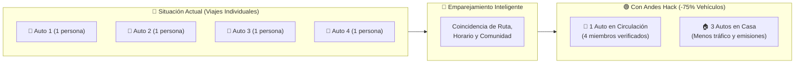
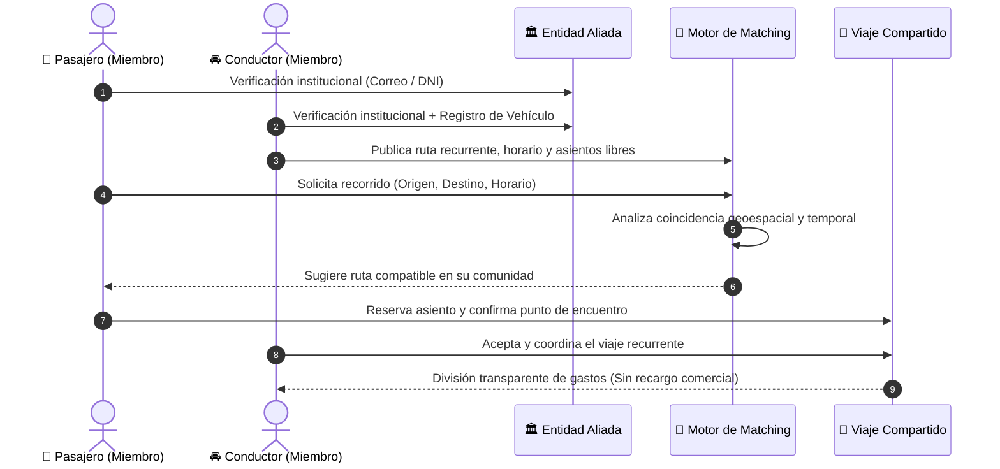
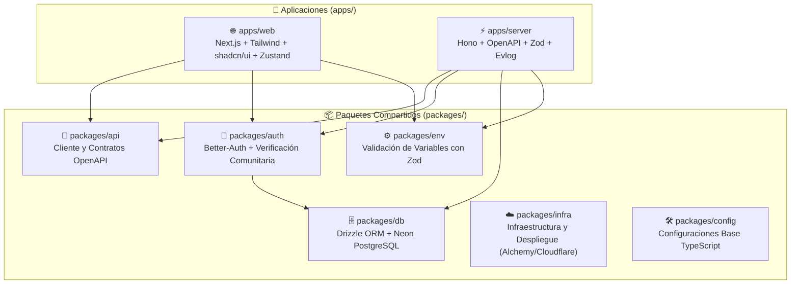

<div align="center">

# 🚗 Andes Hack — Movilidad Compartida Inteligente

### *Conectando comunidades verificadas para transformar el transporte urbano en Lima*

[](https://github.com/hack-andes-buscandoanemo/andes-hack/stargazers)
[](https://github.com/hack-andes-buscandoanemo/andes-hack/commits/main)
[](https://github.com/hack-andes-buscandoanemo/andes-hack/issues)
[](https://github.com/hack-andes-buscandoanemo)

<p align="center">
  
  
  
  
  
  
  
  
  
  
</p>

---

[**🎯 El Problema**](#-problemática-en-lima) · [**💡 La Solución**](#-nuestra-propuesta) · [**🧠 Cómo Funciona**](#-cómo-funciona-el-sistema) · [**🏗️ Arquitectura**](#️-arquitectura-del-monorepo) · [**🚀 Inicio Rápido**](#-inicio-rápido)

</div>

---

## 🌟 Resumen del Proyecto

**Andes Hack** es una plataforma inteligente de **movilidad compartida comunitaria y corporativa** que conecta a miembros de entidades públicas y privadas aliadas con miembros verificados de sus propias comunidades que cuentan con vehículos y ya realizan recorridos similares.

Mediante un **sistema de emparejamiento inteligente**, la aplicación identifica coincidencias entre **rutas, horarios y destinos**, facilitando viajes compartidos **seguros por diseño, coordinados y recurrentes**. De esta manera, aprovecha los asientos disponibles en vehículos particulares, reduce los desplazamientos individuales en automóvil y contribuye a una movilidad urbana más eficiente, humana y sostenible en **Lima**.

> [!IMPORTANT]
> **Filosofía de Gasto Compartido (Sin Ánimo de Lucro Comercial):** A diferencia de los aplicativos de taxi tradicionales, los pasajeros dividen únicamente el costo operativo del viaje (combustible/peajes). Esto garantiza la comodidad y seguridad de un vehículo privado a una tarifa cercana a la del transporte público.

---

## 🚨 Problemática en Lima

El transporte diario en Lima enfrenta una crisis multidimensional que afecta la calidad de vida, la economía y la seguridad de miles de ciudadanos:

<table>
  <tr>
    <td width="50%" valign="top">
      <h3>🛡️ 1. Inseguridad Ciudadana</h3>
      <p>Viajar en transporte público genera ansiedad y tensión constante debido al temor de sufrir robos o atentados. Nuestra plataforma brinda un <b>entorno de confianza cerrado</b> (miembros verificados de instituciones aliadas) a una fracción del costo de un taxi por aplicativo.</p>
    </td>
    <td width="50%" valign="top">
      <h3>⏳ 2. Tiempos de Espera y Saturación</h3>
      <p>En horas punta, servicios como los Corredores Complementarios o el Tren Eléctrico presentan colas extensas y alta congestión en paraderos. El viaje coordinado elimina las esperas prolongadas manteniendo un costo accesible.</p>
    </td>
  </tr>
  <tr>
    <td width="50%" valign="top">
      <h3>⛽ 3. Incentivo para Dejar el Auto en Casa</h3>
      <p>Quienes poseen vehículo propio pueden optar por dejarlo en casa ocasionalmente al contar con un servicio confiable que <b>cuesta menos que asumir individualmente el consumo de gasolina</b> y estacionamiento de su propio auto.</p>
    </td>
    <td width="50%" valign="top">
      <h3>🚦 4. Reducción Real del Tráfico</h3>
      <p>Si <b>4 personas con automóvil</b> comparten una ruta coincidente en un solo vehículo, <b>se retiran 3 vehículos de circulación</b> inmediatamente. Al escalar en múltiples instituciones, el impacto en la descongestión vial y huella de carbono es exponencial.</p>
    </td>
  </tr>
</table>

### 📊 Impacto Directo por Viaje Compartido



---

## 💡 Comparativa de Alternativas

| Criterio | 🚌 Transporte Público | 🚕 Apps de Taxi (Uber, etc.) | 🚗 Auto Propio (Solo) | ✨ **Andes Hack** |
| :--- | :---: | :---: | :---: | :---: |
| **Seguridad y Confianza** | 🔴 Baja | 🟡 Media | 🟢 Alta | 🟢 **Alta (Comunidad Verificada)** |
| **Costo por Viaje** | 🟢 Bajo | 🔴 Alto | 🔴 Alto (Gasolina/Mant.) | 🟢 **Bajo (Gasto Compartido)** |
| **Tiempo de Espera** | 🔴 Alto (Colas en hora punta) | 🟢 Bajo | 🟢 Nulo | 🟢 **Bajo (Horario Coordinado)** |
| **Comodidad** | 🔴 Baja (Saturación) | 🟢 Alta | 🟢 Alta | 🟢 **Alta (Asiento Garantizado)** |
| **Impacto en el Tráfico** | 🟢 Positivo | 🔴 Negativo | 🔴 Muy Negativo | 🟢 **Positivo (-3 autos por grupo)** |

---

## 🧠 ¿Cómo Funciona el Sistema?



---

## 🏗️ Arquitectura del Monorepo

El proyecto está construido sobre un monorepo moderno de alto rendimiento gestionado con **Bun** y **Turborepo**:



### 📂 Estructura de Directorios

```text
andes-hack/
├── apps/
│   ├── web/            # Aplicación Frontend (Next.js 15+, Tailwind CSS, shadcn/ui, Framer Motion)
│   └── server/         # Servidor Backend API (Hono, OpenAPI, Upstash Redis/Ratelimit, Resend)
├── packages/
│   ├── api/            # Contratos de API y generación de tipos con OpenAPI-TypeScript
│   ├── auth/           # Autenticación y sesiones con Better-Auth
│   ├── db/             # Esquemas PostgreSQL (Neon) y migraciones con Drizzle ORM
│   ├── env/            # Variables de entorno tipadas con Zod
│   ├── infra/          # Configuración de infraestructura y despliegue
│   └── config/         # Configuraciones compartidas del workspace
├── AGENTS.md           # Contexto del proyecto y dominio para Agentes de IA
├── CLAUDE.md           # Guía de arquitectura y convenciones para asistentes IA
└── bts.jsonc           # Grafo de stack de Better Fullstack
```

---

## 🚀 Inicio Rápido

### 1. Prerrequisitos

- [**Bun**](https://bun.sh/) `>= 1.2` instalado en tu sistema.
- Base de datos **PostgreSQL** (local mediante Docker o en la nube con **Neon**).

### 2. Instalación

Clona el repositorio e instala las dependencias desde la raíz del monorepo:

```bash
git clone https://github.com/hack-andes-buscandoanemo/andes-hack.git
cd andes-hack
bun install
```

### 3. Variables de Entorno

Copia los archivos `.env.example` en cada aplicación/paquete y configura tus credenciales:

```bash
cp apps/web/.env.example apps/web/.env
cp apps/server/.env.example apps/server/.env
cp packages/infra/.env.example packages/infra/.env
```

### 4. Base de Datos y Desarrollo

Sincroniza el esquema de la base de datos e inicia los servidores de desarrollo:

```bash
# Empujar el esquema a PostgreSQL con Drizzle
bun db:push

# Iniciar frontend y backend en paralelo con Turborepo
bun dev
```

<details>
<summary><b>📋 Ver todos los comandos disponibles</b></summary>

| Comando | Descripción |
| :--- | :--- |
| `bun dev` | Inicia todos los servicios (web + server) en modo desarrollo |
| `bun dev:web` | Inicia únicamente la aplicación frontend (`apps/web`) |
| `bun dev:server` | Inicia únicamente el backend (`apps/server`) |
| `bun build` | Compila todas las aplicaciones y paquetes para producción |
| `bun test` | Ejecuta la suite de pruebas unitarias e integración con Vitest |
| `bun check` | Ejecuta el linter (`oxlint`) y formateador (`oxfmt`) |
| `bun check-types` | Verifica los tipos de TypeScript en todo el monorepo |
| `bun db:push` | Aplica los cambios del esquema Drizzle en la base de datos |
| `bun db:studio` | Abre Drizzle Studio para explorar la base de datos visualmente |
| `bun db:generate` | Genera archivos de migración SQL |
| `bun db:migrate` | Ejecuta las migraciones pendientes |

</details>

---

## 🤖 Soporte para Agentes de IA (AI-First Repo)

Este repositorio está preparado para desarrollo asistido por agentes de IA (Antigravity, Claude Code, Cursor, GitHub Copilot). Toda la especificación de dominio, reglas de negocio y grafo del stack se encuentran documentados en:

- 📄 [`AGENTS.md`](./AGENTS.md) — Contexto integral de producto, arquitectura y reglas para agentes.
- 📄 [`CLAUDE.md`](./CLAUDE.md) — Instrucciones específicas y convenciones de código del monorepo.
- 📄 [`bts.jsonc`](./bts.jsonc) — Definición declarativa del Stack Graph (Better Fullstack).

---

<div align="center">

Desarrollado con ❤️ por el equipo **Buscando a Nemo** para **Hack Andes 2026** 🇵🇪

</div>
