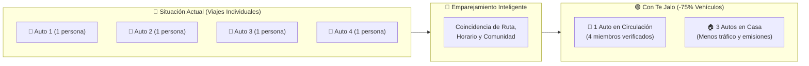
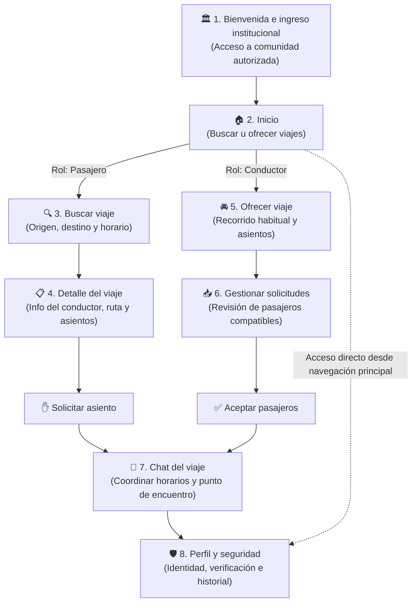
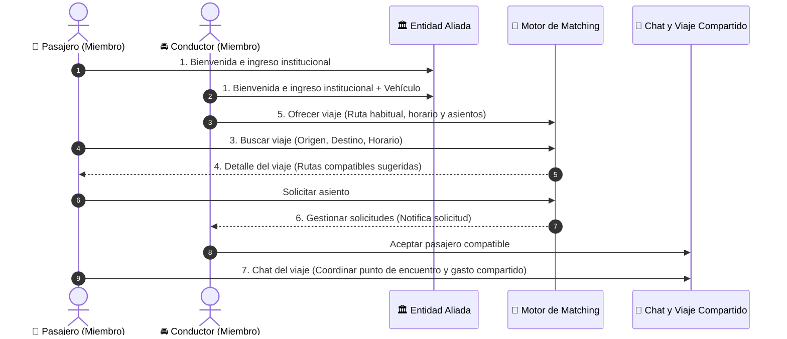
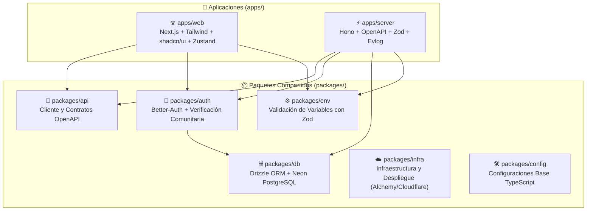

<div align="center">

# 🚗 Te Jalo (`andes-hack`) — Movilidad Compartida Inteligente

### _Conectando comunidades verificadas para transformar el transporte urbano en Lima_

[](https://github.com/hack-andes-buscandoanemo/andes-hack/stargazers)
[](https://github.com/hack-andes-buscandoanemo/andes-hack/commits/main)
[](https://github.com/hack-andes-buscandoanemo/andes-hack/issues)
[](https://github.com/hack-andes-buscandoanemo)

<p align="center">
  
  
  
  
  
  
  
  
  
  
</p>

---

[**🎯 El Problema**](#-problemática-en-lima) · [**💡 Comparativa**](#-comparativa-de-alternativas) · [**🗺️ Flujo de Navegación**](#️-flujo-de-navegación-recomendado--te-jalo) · [**🏗️ Arquitectura**](#️-arquitectura-del-monorepo) · [**🚀 Inicio Rápido**](#-inicio-rápido)

</div>

---

## 🌟 Resumen del Proyecto

**Te Jalo** (`andes-hack`) es una plataforma inteligente de **movilidad compartida comunitaria y corporativa** que conecta a miembros de entidades públicas y privadas aliadas con miembros verificados de sus propias comunidades que cuentan con vehículos y ya realizan recorridos similares.

Mediante un **sistema de emparejamiento inteligente**, la aplicación identifica coincidencias entre **rutas, horarios y destinos**, facilitando viajes compartidos **seguros por diseño, coordinados y recurrentes**. De esta manera, aprovecha los asientos disponibles en vehículos particulares, reduce los desplazamientos individuales en automóvil y contribuye a una movilidad urbana más eficiente, humana y sostenible en **Lima**.

> [!IMPORTANT]
> **Filosofía de Gasto Compartido (Sin Ánimo de Lucro Comercial):** A diferencia de los aplicativos de taxi tradicionales, los pasajeros dividen únicamente el costo operativo del viaje (combustible/peajes). Esto garantiza la comodidad y seguridad de un vehículo privado a una tarifa cercana a la del transporte público.

---

## 🚨 Problemática en Lima

El transporte diario en Lima enfrenta una crisis multidimensional que afecta la calidad de vida, la economía y la seguridad de miles de ciudadanos:

<table>
  <tr>
    <td width="50%" valign="top">
      <h3>🛡️ 1. Inseguridad Ciudadana</h3>
      <p>Viajar en transporte público genera ansiedad y tensión constante debido al temor de sufrir robos o atentados. Nuestra plataforma brinda un <b>entorno de confianza cerrado</b> (miembros verificados de instituciones aliadas) a una fracción del costo de un taxi por aplicativo.</p>
    </td>
    <td width="50%" valign="top">
      <h3>⏳ 2. Tiempos de Espera y Saturación</h3>
      <p>En horas punta, servicios como los Corredores Complementarios o el Tren Eléctrico presentan colas extensas y alta congestión en paraderos. El viaje coordinado elimina las esperas prolongadas manteniendo un costo accesible.</p>
    </td>
  </tr>
  <tr>
    <td width="50%" valign="top">
      <h3>⛽ 3. Incentivo para Dejar el Auto en Casa</h3>
      <p>Quienes poseen vehículo propio pueden optar por dejarlo en casa ocasionalmente al contar con un servicio confiable que <b>cuesta menos que asumir individualmente el consumo de gasolina</b> y estacionamiento de su propio auto.</p>
    </td>
    <td width="50%" valign="top">
      <h3>🚦 4. Reducción Real del Tráfico</h3>
      <p>Si <b>4 personas que manejaban solas</b> comparten un solo vehículo, <b>se retiran 3 autos de circulación</b> (de 4 autos a 1). Si solo <b>3 de las 4</b> comparten, se retiran 2 (de 4 autos a 2). Quien venía en bus, combi, Corredor o metro gana seguridad y tiempo, pero no resta autos: por eso medimos los <b>viajes en auto evitados</b> aparte de las <b>personas transportadas</b>. El impacto crece con cada institución que se suma.</p>
    </td>
  </tr>
</table>

### 📊 Impacto Directo por Viaje Compartido



---

## 💡 Comparativa de Alternativas

| Criterio                  |     🚌 Transporte Público     | 🚕 Apps de Taxi (Uber, etc.) |  🚗 Auto Propio (Solo)   |            ✨ **Te Jalo**            |
| :------------------------ | :---------------------------: | :--------------------------: | :----------------------: | :----------------------------------: |
| **Seguridad y Confianza** |            🔴 Baja            |           🟡 Media           |         🟢 Alta          |  🟢 **Alta (Comunidad Verificada)**  |
| **Costo por Viaje**       |            🟢 Bajo            |           🔴 Alto            | 🔴 Alto (Gasolina/Mant.) |    🟢 **Bajo (Gasto Compartido)**    |
| **Tiempo de Espera**      | 🔴 Alto (Colas en hora punta) |           🟢 Bajo            |         🟢 Nulo          |   🟢 **Bajo (Horario Coordinado)**   |
| **Comodidad**             |     🔴 Baja (Saturación)      |           🟢 Alta            |         🟢 Alta          |  🟢 **Alta (Asiento Garantizado)**   |
| **Impacto en el Tráfico** |          🟢 Positivo          |         🔴 Negativo          |     🔴 Muy Negativo      | 🟢 **Positivo (hasta -3 por grupo)** |

---

## 🗺️ Flujo de Navegación Recomendado — Te Jalo

La experiencia de usuario en **Te Jalo** se estructura en **8 vistas clave** que conectan a pasajeros y conductores dentro de su comunidad autorizada:



<details>
<summary><b>📐 Ver Diagrama de Flujo en texto (ASCII)</b></summary>

```text
1. Bienvenida e ingreso institucional
                 │
                 ▼
             2. Inicio
                 │
         ┌───────┴───────┐
         ▼               ▼
      PASAJERO        CONDUCTOR
         │               │
         ▼               ▼
  3. Buscar viaje   5. Ofrecer viaje
         │               │
         ▼               ▼
  4. Detalle del    6. Gestionar
      viaje            solicitudes
         │               │
         ▼               ▼
  Solicitar asiento  Aceptar pasajeros
         │               │
         └───────┬───────┘
                 │
                 ▼
        7. Chat del viaje
                 │
                 ▼
       8. Perfil y seguridad
```

</details>

### 📱 Detalle de Pantallas del Flujo

|   #   | Pantalla / Módulo                      |     Rol      | Descripción Funcional                                                                                                   |
| :---: | :------------------------------------- | :----------: | :---------------------------------------------------------------------------------------------------------------------- |
| **1** | **Bienvenida e ingreso institucional** |    Ambos     | Acceso y validación del miembro dentro de una comunidad o entidad aliada autorizada.                                    |
| **2** | **Inicio**                             |    Ambos     | Pantalla principal de la aplicación desde donde el usuario elige buscar u ofrecer viajes.                               |
| **3** | **Buscar viaje**                       | 👤 Pasajero  | El pasajero busca rutas compatibles según su origen, destino y ventana horaria.                                         |
| **4** | **Detalle del viaje**                  | 👤 Pasajero  | El pasajero revisa la información del conductor, recorrido y asientos disponibles para **solicitar un asiento**.        |
| **5** | **Ofrecer viaje**                      | 🚘 Conductor | El conductor publica su recorrido habitual, días/horarios e indica los asientos disponibles.                            |
| **6** | **Gestionar solicitudes**              | 🚘 Conductor | El conductor revisa las solicitudes recibidas y **acepta pasajeros compatibles** de su comunidad.                       |
| **7** | **Chat del viaje**                     |    Ambos     | Coordinación directa entre conductor y pasajeros para confirmar horarios, puntos de encuentro y detalles del recorrido. |
| **8** | **Perfil y seguridad**                 |    Ambos     | Gestión de identidad, verificación institucional, historial de viajes y preferencias personales.                        |

> [!NOTE]
> **Acceso Global:** El módulo **8. Perfil y seguridad** es accesible desde la navegación principal en cualquier momento, no únicamente después del chat del viaje.

---

## 🧠 Secuencia de Interacción del Sistema



---

## 🏗️ Arquitectura del Monorepo

El proyecto está construido sobre un monorepo moderno de alto rendimiento gestionado con **Bun** y **Turborepo**:



### 📂 Estructura de Directorios

```text
andes-hack/
├── apps/
│   ├── web/            # Aplicación Frontend (Next.js 15+, Tailwind CSS, shadcn/ui, Framer Motion)
│   └── server/         # Servidor Backend API (Hono, OpenAPI, Upstash Redis/Ratelimit, Resend)
├── packages/
│   ├── api/            # Contratos de API y generación de tipos con OpenAPI-TypeScript
│   ├── auth/           # Autenticación y sesiones con Better-Auth
│   ├── db/             # Esquemas PostgreSQL (Neon) y migraciones con Drizzle ORM
│   ├── env/            # Variables de entorno tipadas con Zod
│   ├── infra/          # Configuración de infraestructura y despliegue
│   └── config/         # Configuraciones compartidas del workspace
├── AGENTS.md           # Contexto del proyecto y dominio para Agentes de IA
├── CLAUDE.md           # Guía de arquitectura y convenciones para asistentes IA
└── bts.jsonc           # Grafo de stack de Better Fullstack
```

---

## 🚀 Inicio Rápido

### 1. Prerrequisitos

- [**Bun**](https://bun.sh/) `>= 1.2` instalado en tu sistema.
- Base de datos **PostgreSQL** (local mediante Docker o en la nube con **Neon**).

### 2. Instalación

Clona el repositorio e instala las dependencias desde la raíz del monorepo:

```bash
git clone https://github.com/hack-andes-buscandoanemo/andes-hack.git
cd andes-hack
bun install
```

### 3. Variables de Entorno

Copia los archivos `.env.example` en cada aplicación/paquete y configura tus credenciales:

```bash
cp apps/web/.env.example apps/web/.env
cp apps/server/.env.example apps/server/.env
cp packages/infra/.env.example packages/infra/.env
```

### 4. Base de Datos y Desarrollo

Aplica las migraciones versionadas de la base de datos e inicia los servidores de desarrollo:

```bash
# Generar y aplicar migraciones versionadas a PostgreSQL (Neon) con Drizzle
bun db:generate
bun db:migrate

# Cargar los lugares reales de Lima y la comunidad demo (DEMO_JOIN_CODE y DEMO_ADMIN_EMAIL en .env)
bun db:seed

# Iniciar frontend y backend en paralelo con Turborepo
bun dev
```

### 5. URLs Públicas y Despliegue en Vivo (Cloudflare + Alchemy)

- **Web pública (`apps/web`):** [`https://andes-hack-web-diego.diegorafaelcisnerostafur.workers.dev`](https://andes-hack-web-diego.diegorafaelcisnerostafur.workers.dev)
- **API pública (`apps/server`):** [`https://andes-hack-server-diego.diegorafaelcisnerostafur.workers.dev`](https://andes-hack-server-diego.diegorafaelcisnerostafur.workers.dev)
  - Healthcheck: [`GET /health`](https://andes-hack-server-diego.diegorafaelcisnerostafur.workers.dev/health) → `{ "status": "ok" }`
  - Referencia OpenAPI: [`GET /docs`](https://andes-hack-server-diego.diegorafaelcisnerostafur.workers.dev/docs)

Para volver a desplegar la web y la API en producción:

```bash
# 1. Autenticarse en Cloudflare (una sola vez) o configurar CLOUDFLARE_API_TOKEN en packages/infra/.env
bun --cwd packages/infra alchemy login cloudflare

# 2. Aplicar migraciones pendientes en Neon
bun db:migrate

# 3. Desplegar API (Cloudflare Worker) y Web (OpenNext Cloudflare)
bun --cwd packages/infra deploy
```

<details>
<summary><b>📋 Ver todos los comandos disponibles</b></summary>

| Comando           | Descripción                                                    |
| :---------------- | :------------------------------------------------------------- |
| `bun dev`         | Inicia todos los servicios (web + server) en modo desarrollo   |
| `bun dev:web`     | Inicia únicamente la aplicación frontend (`apps/web`)          |
| `bun dev:server`  | Inicia únicamente el backend (`apps/server`)                   |
| `bun build`       | Compila todas las aplicaciones y paquetes para producción      |
| `bun run test`    | Ejecuta la suite de pruebas unitarias e integración con Vitest |
| `bun check`       | Ejecuta el linter (`oxlint`) y formateador (`oxfmt`)           |
| `bun check-types` | Verifica los tipos de TypeScript en todo el monorepo           |
| `bun db:push`     | Aplica los cambios del esquema Drizzle en la base de datos     |
| `bun db:studio`   | Abre Drizzle Studio para explorar la base de datos visualmente |
| `bun db:generate` | Genera archivos de migración SQL                               |
| `bun db:migrate`  | Ejecuta las migraciones pendientes                             |
| `bun db:seed`     | Carga los lugares reales de Lima y la comunidad demo           |

</details>

## 🧪 Estándares de Ingeniería y Flujo de Trabajo

Para garantizar la máxima calidad técnica y trazabilidad de nuestras decisiones arquitectónicas, este repositorio aplica reglas estrictas impulsadas por **[Agent Skills](./.agents/skills/)**:

### 1. 🔴🟢 Strict TDD en Seams y Vertical Slices ([`.agents/skills/tdd/`](./.agents/skills/tdd/SKILL.md))

Cada funcionalidad, algoritmo de _Smart Matching_ o endpoint de API se desarrolla siguiendo el bucle **Red → Green** con **Vitest**:

1. **Seams acordados:** Las pruebas viven únicamente en fronteras públicas (_seams_), verificando **QUÉ** hace el sistema y nunca detalles internos de implementación.
2. **Vertical Slicing (_Tracer Bullets_):** Una rebanada vertical a la vez (`1 seam → 1 test en RED → 1 implementación mínima en GREEN → repetir`), evitando el _horizontal slicing_ y los tests tautológicos.
3. **Mocking solo en Fronteras del Sistema:** Solo se mockean integraciones externas (APIs de terceros, reloj/aleatoriedad, correo) mediante inyección de dependencias estilo SDK ([`mocking.md`](./.agents/skills/tdd/mocking.md)).
4. **Revisión y Refactoring:** La refactorización se ejecuta tras completar el ciclo usando la skill [`code-review`](./.agents/skills/code-review/SKILL.md) junto con los _Quality Gates_ (`bun run test`, `bun check-types`, `bun check`).

### 2. 🌿 Siempre PRs o Stacked PRs vía GitHub CLI (`gh`) ([`.agents/skills/pr/`](./.agents/skills/pr/SKILL.md))

No se realizan _pushes_ directos a `main` durante el desarrollo de funcionalidades. Todo cambio ingresa mediante **Pull Requests atómicos** o **Stacked PRs** (PRs apilados por capas: `DB Schema` → `Backend API` → `Frontend UI`) creados desde la terminal con `gh pr create`, documentando diagramas/flujos, evidencia _Before/After_, **decisiones técnicas, tradeoffs y Merge Danger**.

---

## 🤖 Soporte para Agentes de IA (AI-First Repo)

Este repositorio está preparado para desarrollo asistido por agentes de IA (Antigravity, Claude Code, Cursor, GitHub Copilot). Toda la especificación de dominio, **rúbrica de evaluación del hackathon**, reglas de negocio y catálogo de skills se encuentran en:

- 📄 [`AGENTS.md`](./AGENTS.md) — Contexto integral de producto, rúbrica de evaluación (75% Técnico / 25% Producto), arquitectura y reglas estrictas para agentes.
- 📄 [`CLAUDE.md`](./CLAUDE.md) — Instrucciones específicas y convenciones de código del monorepo.
- 🧠 [`.agents/skills/`](./.agents/skills/) — Suite de 36+ Agent Skills (`tdd`, `codebase-design`, `domain-modeling`, `code-review`, `pr`, `grill-me`, `diagnosing-bugs`, `ponytail`, etc.) bloqueadas en [`skills-lock.json`](./skills-lock.json).
- 📄 [`bts.jsonc`](./bts.jsonc) — Definición declarativa del Stack Graph (Better Fullstack).

---

<div align="center">

Desarrollado con ❤️ por el equipo **Buscando a Nemo** para **Hack Andes 2026** 🇵🇪

</div>
